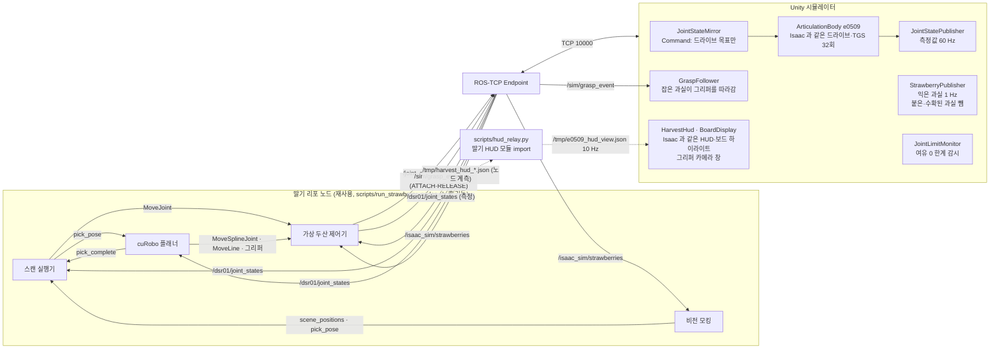
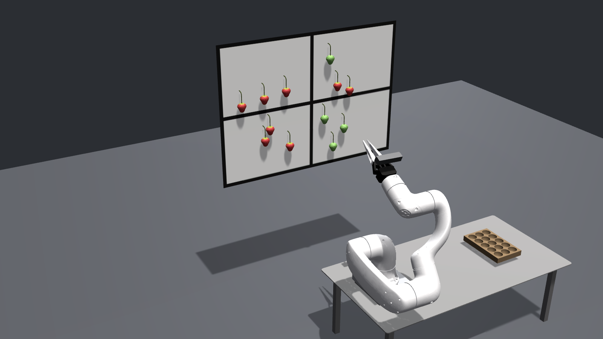

# 상세 문서

두산 e0509를 Unity에 세우고, 딸기 수확 프로젝트(Isaac Sim)의 ROS 2 제어 스택을 재사용해 연결한 두 번째 시뮬레이터

루트 [README.md](../README.md) 는 요약이고, 이 문서가 토픽 계약·측정치 전체·화면·한계·출처를 담는다.

- 딸기 리포와의 경계 계약: [docs/CONTRACT.md](CONTRACT.md)
- 단계별 진행 기록: [docs/PROGRESS.md](PROGRESS.md)
- 수동 단계(에디터 확인·Isaac 녹화): [docs/HUMAN_STEPS.md](HUMAN_STEPS.md)

## 영상 (30초)

https://github.com/user-attachments/assets/434eb4d9-ba1d-4dd2-9359-bc36c58b0ad5

[docs/media/m2_run_30s.mp4](media/m2_run_30s.mp4) (1920×1080, 30 fps, H.264, 5.3 MB, 위 재생기는 같은 파일을 GitHub 첨부로 올린 것) — Isaac 없이 도는 M2 루프. 딸기 리포 노드 4개(플래너·스캔 실행기·비전 모킹·가상 두산 제어기)가 Unity 플랜트를 움직이는 장면을 에디터 Game 뷰에서 실제 시간으로 녹화했다. 런의 두 번째 픽 한 사이클(하강·잡기·당김·계란판 위에서 놓기·복귀)이다. 왼쪽 위는 Isaac 과 같은 HUD(딸기 노드 계측 중계), 왼쪽 아래는 그리퍼 D455 카메라 창, 오른쪽 위는 Unity 진단 패널(연결·발행 Hz·한계·관절각)이다. 잡은 딸기가 그리퍼를 따라가는 것은 `/sim/grasp_event` 처리이고, 파지 판정은 가상 제어기가 한다. 원본 녹화 190 s 의 60–90 s 구간(`logs/m2/20261022_091701_m2_editor`).

영상은 그리퍼의 D455 본체를 상자로 바꾸기 전에 찍어 실제 D455 모양이 보인다. 리포에는 NVIDIA 자산 형상 대신 부품별 상자가 들어 있다([THIRD_PARTY.md](../THIRD_PARTY.md) §2-1).

## 개요

딸기 수확 프로젝트는 플래너(cuRobo)·스캔 실행기·비전 모킹이 가상 두산 제어기를 거쳐 Isaac Sim 의 로봇을 움직인다. 이 리포는 그 제어 스택을 고치지 않고 Isaac 자리에 Unity 시뮬레이터(두 번째 엔진)를 끼운다. 딸기 리포의 URDF 를 Unity 로 가져와 ArticulationBody 로 세우고(URDF Importer), ROS-TCP 로 ROS 2 와 연결해 Isaac 이 하던 플랜트 역할을 한다: `/joint_command` 를 드라이브 목표로 받아 실제로 움직인 관절값을 `/dsr01/joint_states` 로 돌려주고, 과실 좌표를 `/isaac_sim/strawberries` 로 낸다. 기존 제어 스택을 재사용한 관절 시퀀스 구동이고, 운동학 구동(드라이브 추종)과 관절 한계 감시가 범위다. 동역학 검증은 범위 밖이다. 이번 작업에서 딸기 리포 파일 변경 없음(노드 로그·캐시도 이 리포 `logs/` 로 보냈고, 런마다 딸기 리포의 git 상태를 무시 파일까지 비교했다).

## 구조



파지 판정은 Unity 가 아니라 가상 제어기가 한다: 닫기 명령 순간 Unity 가 보낸 측정 관절값으로 FK 를 풀고 과실 좌표와 비교한다(CONTRACT §3-5). 그래서 Unity 가 명령을 그대로 되돌려 보내면 실패를 못 잡는다 — Command 모드는 드라이브 목표만 주고, 측정값은 물리 스텝 뒤의 관절값이다.

## 실행

준비: ROS 2 Humble, Unity 2022.3.62f2(Hub), 딸기 워크스페이스 빌드(`~/strawberry_grasp_environment/install` — 비공개 리포라 M2 와 bag 미러는 이 리포만으로 돌릴 수 없다), `ros/` 의 ROS-TCP-Endpoint 클론·빌드(`git clone -b ROS2v0.7.0 https://github.com/Unity-Technologies/ROS-TCP-Endpoint.git ros/src/ROS-TCP-Endpoint` 뒤 `cd ros && colcon build`). 딸기 리포 없이 되는 범위는 README 의 실행 절 표를 따른다. 처음 한 번 `bash scripts/check_env.sh` 로 환경을 점검하고 Unity 에디터 경로를 `scripts/env.sh` 에 저장한 뒤, Unity 프로젝트를 설정한다(에디터를 닫은 상태):

```bash
bash scripts/unity_batch.sh 03 configure -executeMethod SimSetup.ConfigureProject
```
```bash
bash scripts/unity_batch.sh 04 build_scene -executeMethod SimSetup.BuildScene
```

### M1 — 관절 상태 미러 (Mirror 모드)

받은 `/dsr01/joint_states`(Isaac 측정값)를 그대로 재생한다. 기본은 Isaac 런 bag(실제 수확 시퀀스, `/sim/grasp_event` 포함 — 잡은 딸기가 그리퍼를 따라간다). bag 은 리포에 없으므로 이 리포만으로는 가짜 퍼블리셔(`run_m1.sh fake`, `unity_test_m1.sh` 기본값)로 돌린다:

```bash
bash scripts/run_m1.sh bag ~/bags/run1
```
그다음 `bash scripts/open_editor.sh mirror` (에디터가 열리고 Play 까지 자동). 가짜 퍼블리셔(`run_m1.sh fake`)는 사인파로 한계 근처를 훑는 한계 감시 시험용이다. 헤드리스 확인: `M1_OBSERVE_SECONDS=330 M1_EXPECT_GRASPS=7 bash scripts/unity_test_m1.sh bag ~/bags/run1 -d 5 --topics /dsr01/joint_states /sim/grasp_event`.

### M2 — 루프 완결 (Command 모드, Isaac 없이)

```bash
bash scripts/run_m2_headless.sh
```
엔드포인트 → Unity 플랜트(batchmode) → overview 자세 확인 → 딸기 노드 4개(기동 로그 대조) → 트리거 → `SCAN_COMPLETE` 까지 돌고 `logs/m2/<시각>_m2_headless/summary.txt` 를 쓴다. 에디터 화면으로 보려면 `--plant editor` 를 주고 에디터에서 Mode=Command 로 Play 한다(docs/HUMAN_STEPS.md H3-2). Command 모드 수렴 시험(ROS 없이): `bash scripts/unity_test_command.sh`.

## 토픽 계약 (Unity 가 Isaac 대신 지키는 것, CONTRACT §3-6)

| 토픽 | 방향 | 타입 | Unity 동작 |
|---|---|---|---|
| `/dsr01/joint_states` | Unity → ROS | `sensor_msgs/JointState` | Command 모드에서 물리 스텝마다(60 Hz). name 은 Isaac 순서 10개 고정(`joint_1..6, rh_l1, rh_p12_rn, rh_l2, rh_r2`), position 은 측정값 rad·감싸지 않은 연속 각, velocity·effort 비움. 유휴 중에도 계속 |
| `/joint_command` | ROS → Unity | `sensor_msgs/JointState` | 이름으로 매핑, 최신 1개만 다음 물리 스텝에 드라이브 목표로 적용, 모르는 이름 무시(이름당 1회 경고) |
| `/isaac_sim/strawberries` | Unity → ROS | `geometry_msgs/PoseArray` | 익은 과실 8개 중심(m, Z-up), frame `world`, 약 1 Hz. 그리퍼에 붙은 과실과 수확된(RELEASE 된) 과실은 뺀다(Isaac 과 같다) |
| `/dsr01/joint_states` (M1) | ROS → Unity | `sensor_msgs/JointState` | Mirror 모드에서 구독, 이름으로 매핑해 위치를 그대로 대입 |
| `/sim/grasp_event` | ROS → Unity | `std_msgs/String` | Isaac 브릿지와 같은 규칙(CONTRACT §9-4 D-6): `ATTACH x y z` = 60 mm 안의 수확 안 된 익은 과실 최근접을 그리퍼 밑동에 붙여 따라가게, `RELEASE` = 떼어 수확됨 표시 후 놓인 자리에서 아래로 떨어뜨림(계란판 상자 안이면 트레이 배치로 셈). 두 모드 모두 |

시작 자세 overview `[87.98, −94.92, 129.89, 175.94, −31.34, 93.42]°`·그리퍼 0.926 rad, ROS 도메인 0, QoS 기본, 로봇 베이스 = 월드 원점.

## 측정치

모두 같은 PC(RTX 4060 Ti, Ubuntu 22.04)에서 잰 값이다. 근거 파일은 괄호 안 경로.

| 항목 | 값 |
|---|---|
| ROS-TCP 엔드포인트 왕복 지연 (Unity 대신 TCP 클라이언트, JointState 100개) | p50 0.57–0.73 ms · p95 0.94–1.03 ms (단계 2, docs/PROGRESS.md) |
| M1 미러 (가짜 퍼블리셔 60 Hz) | 수신 59.7–60.0 Hz, 명령−측정 최대 0.00002°, 한계 밖 펄스(J3 137°) 위반 1건 정확히 셈 (`logs/m1/20261020_202903_fake`, `logs/m1/20261021_172245_fake_limit_test`) |
| Command 모드 수렴 (ROS 없이, 2° 계단 J3 133→135.0°) | 0.20 s 에 0.3° 안, J2 −94.919° 유지, 위반 0 (`logs/m2/20261021_172217_command_mode_PASS`) |
| Command 모드 사다리꼴 추종 (60/90, 120/180 °/s·°/s²) | 끝난 뒤 0.13–0.22 s 에 0.3° 도착, 경로 중 추종 지연 5.9–7.9°, 위반 0 |
| M2 런 ① (스캔 60/90) | 305.0 s 완주, 가상 제어기 도착 ARM_ARRIVAL 80·STALLED 0·TIMEOUT 0, 픽 8 중 가상 제어기 접촉 판정 7, 한계 위반 0·근처 6, `/dsr01/joint_states` 60.0 Hz(0.34 s 간격 1회, 시각 미기록) (`logs/m2/20261021_170043_m2_headless`) |
| M2 런 ② (스캔 60/90) | 291.3 s 완주, 74·0·0, 픽 8 중 접촉 판정 6, 한계 위반 0·근처 4, 59.999 Hz·최대 간격 0.059 s (`logs/m2/20261021_170818_m2_headless`) |
| M2 런 ③ (스캔 60/90, 회귀) | 319.5 s 완주, 84·0·0, 픽 8 중 접촉 판정 8, 한계 위반 0·근처 6, 59.999 Hz·최대 간격 0.064 s (`logs/m2/20261021_171524_m2_headless`) |
| M2 런 ④ (화면 개선 뒤 최종 씬) | 312.8 s 완주, 80·0·0, 픽 8 중 접촉 판정 7, 한계 위반 0·근처 6, 60.0 Hz·최대 간격 0.059 s, `/isaac_sim/strawberries` 1.0 Hz·8개 (`logs/m2/20261021_184458_m2_headless`) |
| `/joint_command` 수신 | 런 평균 약 26 개/s (가상 제어기는 이동 중에만 보낸다) |
| 참고: Isaac 완주 런 `run_logs/20261014_002919` (스캔 120/180) | 334.5 s, 73·0·0, 접촉 판정 8. **스캔 속도가 달라(120/180 vs 60/90) 시간은 비교 대상이 아니다** |
| M1 bag 재생 (Isaac 런 녹화 `~/bags/run1`, 스캔 60/90) | 300 s 동안 54.2 Hz 수신, 받은 값−Unity 측정 최대 0.000°(10축), J4 −13.5→347.5° 연속 각, Isaac 궤적 한계 위반 0·근처 4(시작 J2 −94.92°, J3 135.000° 도달), 그리퍼 1.0 rad 초과는 정보 기록 (`logs/m1/20261021_183335_bag_isaac_run1`) |
| M2 런 ⑤ (10-21 D-6 개정 뒤: 과실 제외·따라가기·HUD 중계) | 276.9 s 완주, 75·0·0, 접촉 판정 7·빈손 1, 한계 위반 0·근처 6, 60.02 Hz·최대 간격 0.236 s. 잡은 과실 7개 모두 그리퍼를 따라갔고, Unity 판정 계란판 6·밖 1 = 플래너 기록 PLACE_RELEASE 6·place_failed 1. `/isaac_sim/strawberries` 1.0 Hz, 과실 수 8→1 (`logs/m2/20261021_201041_m2_headless`) |
| M1 bag 재생 + 잡은 과실 따라가기 (`/sim/grasp_event` 함께) | 330 s, 54.5 Hz, 받은 값−측정 0.000°, ATTACH·RELEASE 7·7, 무시 0. Unity 판정 계란판 4(22–31 mm 낙하)·바닥 3 = Isaac 런 플래너 기록 PLACE_RELEASE 4·place_failed 3 (`logs/m1/20261021_200450_bag_grasp`) |
| 그리퍼 손가락 간격 (Unity vs URDF 순기구학, 네 관절 같은 각) | 0° 102.76 · 30° 61.03 · 53.05° 17.82 · 57.3° 9.40 · 61.88° 0.29 mm — 둘이 같다(겹치지 않음). 가짜 퍼블리셔가 관절마다 위상을 달리 주던 때(10-21 전)는 근위·원위 관절이 최대 13° 어긋나 손가락이 겹쳤다 (`logs/m2/20261021_200409_screen_tests`) |
| 잡은 과실 운반 (bag 첫 픽 관절값, ROS 없이) | ATTACH 순간 TCP–과실 36 mm(플래너 `pick_target_z_bias` 35 mm), 운반 중 그리퍼 기준 위치 변화 최대 0.0007 mm (같은 폴더 `grasp_follow_test.json`) |
| 영상 녹화 중 에디터 플랜트 (Recorder WebM 1080p, VP8 20 Mbps 설정) | 녹화한 191 s 동안 `/dsr01/joint_states` 59.98 Hz·최대 간격 0.145 s·0.3 s 넘는 간격 0, 픽 4번 잡기·놓기(계란판 3·바닥 1), 한계 위반 0. 녹화를 멈출 때 Recorder 기본 설정(Exit Play Mode)이 Play 를 끝내 플랜트가 끊겼고 그 뒤 도착 타임아웃 2 → 완주 런이 아니라 녹화 부하 확인용 (`logs/m2/20261022_091701_m2_editor`) |
| Isaac `/dsr01/joint_states` 벽시계 Hz | bag 기준 평균 54.7 Hz(344.6 s, 18,836개), 최대 간격 0.076 s. 녹화 중 `ros2 topic hz` 는 약 60 근처를 오갔다(눈으로 본 값) |

M2 런에서 접촉 판정이 8보다 적은 픽은 가상 제어기 MoveLine 의 IK 단계 실패로 플래너가 그 픽을 중단한 경우다(플랜트가 멈춘 것이 아니다). 보존된 Isaac 완주 런 77개 중 24개에도 같은 실패가 있다(CONTRACT §9-5).

## M2 런 판정

"완주"는 `scripts/m2_summary.py` 의 M2 완료 판정이 '예'인 런이다. 네 조건을 모두 채워야 한다: 도착 타임아웃 0(ARM_ARRIVAL_TIMEOUT 0), 시퀀스 완주(SCAN_COMPLETE, EXEC_TIMEOUT 0, START_REJECTED 0), 픽 시도·종료(PICK_TRIGGER 1회 이상이고 전부 PICK_ATTEMPT_DONE — 10-22 추가), 상태 주기(`/dsr01/joint_states` 평균 50 Hz 이상, 0.3 s 넘는 간격 0). 10-24 에 `logs/m2/` 의 M2 런 폴더 15개를 사본으로 지금 요약기에 다시 넣었고, 판정은 15개 모두 각 폴더 `summary.txt` 와 같다(10-22 전 폴더 6개의 `summary.txt` 에는 픽 조건 줄이 없지만 판정은 같다). 그 뒤 런은 처음부터 지금 요약기로 판정했다.

세는 런 11개 (스캔 60/90, 픽 8회씩, 딸기 리포 변화 없음 모두 True):

| 런 폴더 `logs/m2/…` | 플랜트 | 시작→완료 | 도착 ARRIVAL·STALLED·TIMEOUT | 접촉 판정 / 픽 | 상태 Hz · 최대 간격 | 한계 위반 · 근처 | 그때 바뀐 것 |
|---|---|---|---|---|---|---|---|
| `20261021_170818_m2_headless` | 헤드리스 | 291.3 s | 74·0·0 | 6 / 8 | 59.999 · 0.059 s | 0 · 4 | 정적 과실 목록 |
| `20261021_171524_m2_headless` | 헤드리스 | 319.5 s | 84·0·0 | 8 / 8 | 59.999 · 0.064 s | 0 · 6 | 오케스트레이터 수정 뒤 회귀 |
| `20261021_181905_m2_editor` | 에디터 | 296.5 s | 80·0·0 | 7 / 8 | 59.999 · 0.063 s | 0 · 6 | 직접 Play 한 에디터 |
| `20261021_184458_m2_headless` | 헤드리스 | 312.8 s | 80·0·0 | 7 / 8 | 60.0 · 0.059 s | 0 · 6 | 최종 씬(환경·카메라·화질) |
| `20261021_201041_m2_headless` | 헤드리스 | 276.9 s | 75·0·0 | 7 / 8 | 60.02 · 0.236 s | 0 · 6 | D-6 개정(과실 제외·따라가기)·HUD 중계 |
| `20261021_212659_m2_editor` | 에디터 | 284.2 s | 79·0·0 | 8 / 8 | 59.999 · 0.175 s | 0 · 6 | 화면 3차 뒤 에디터 런 |
| `20261022_002740_m2_editor` | 에디터 | 288.0 s | 79·0·0 | 8 / 8 | 60.0 · 0.108 s | 0 · 6 | 에디터 확인 런 |
| `20261022_012542_m2_headless` | 헤드리스 | 301.3 s | 79·0·0 | 8 / 8 | 59.999 · 0.099 s | 0 · 6 | Recorder 추가 뒤 |
| `20261022_015746_m2_headless` | 헤드리스 | 289.9 s | 75·0·0 | 7 / 8 | 59.999 · 0.102 s | 0 · 6 | 실행 스크립트 중단 처리 수정 뒤 |
| `20261022_161315_m2_headless` | 헤드리스 | 279.1 s | 75·0·0 | 7 / 8 | 60.027 · 0.103 s | 0 · 6 | D455 본체 → 경계 상자 뒤 |
| `20261024_084151_m2_headless` | 헤드리스 | 273.7 s | 75·0·0 | 7 / 8 | 60.019 · 0.093 s | 0 · 6 | 두산 .dae 수정 고지 주석 뒤 |

접촉 판정은 가상 제어기의 GRASP_ATTACH 수다(Unity 는 파지 판정을 하지 않는다). 8보다 적은 픽은 가상 제어기 MoveLine IK 단계 실패로 플래너가 그 픽을 중단한 경우다(CONTRACT §9-5). 한계 위반은 헤드리스 런이 `unity_plant_report.json`, 에디터 런이 폴더의 `limit_violations.csv` 의 `counted=1` 행 수다(에디터 런 세 개는 그리퍼 1 rad 초과 정보 행 28–32개뿐).

세지 않은 런 5개:

| 런 폴더 `logs/m2/…` | 판정에서 빠진 조건 | 사정 |
|---|---|---|
| `20261021_170043_m2_headless` (런 ①) | 상태 주기 | 시퀀스는 완주했지만(305.0 s, 80·0·0, 위반 0) 상태 발행에 0.34 s 간격이 한 번 있다. 10-21 기준 "완주 5회"에 들어 있던 런 |
| `20261022_003302_m2_editor` | 픽 시도·종료 | 같은 Play 로 이어 돌려 익은 과실 0개 → 3.1 s 만에 SCAN_COMPLETE, 픽 0회. 요약기 거짓 통과를 고친 계기 |
| `20261022_003352_m2_editor` | 시퀀스 완주·픽 시도·종료·상태 주기 | 픽 3회 시도 중 일부러 멈춤 |
| `20261022_014336_m2_headless` | 시퀀스 완주·픽 시도·종료 | 중단 처리 시험(트리거 10 s 뒤 Ctrl-C) |
| `20261022_091701_m2_editor` | 도착 타임아웃 0·시퀀스 완주 | 영상 녹화 런. STOP RECORDING 이 Play 를 끝내 플랜트가 끊겼고 그 뒤 도착 타임아웃 2 |

## 화면

Isaac 씬(`strawberry_harvest/scenes/main_scene.usd`)의 정적 형상을 같은 배치로 가져왔다: 바닥·책상(상판·다리)·로봇 받침판·4분면 보드·딸기 12개(Isaac 딸기 메쉬·텍스처)·줄기·계란판. 그리퍼의 RealSense D455 본체는 NVIDIA 자산이라 형상을 옮기지 않고 부품 8개를 각자의 경계 상자(크기·자리만)로 둔다(THIRD_PARTY.md). 손목 카메라의 자리·화각은 Isaac 카메라 그대로이고 본체는 손목 카메라 화면에서 빠지므로 카메라 창 화면은 상자로 바꾸기 전과 같다. `scripts/export_isaac_scene.py` 가 딸기 리포 USD 를 읽기만 해서 `assets_src/scene/` 에 내보내고, `SimSetup.BuildScene` 이 콜라이더 없는 Environment 로 만든다. 딸기 메쉬 중심은 `/isaac_sim/strawberries` 로 내는 고정 좌표와 1.6 mm 안이다(발행 좌표는 메쉬가 아니라 CONTRACT §3-1 목록에서 낸다). 로봇 재질은 도장면처럼 무광, 조명은 Isaac 의 위쪽 사각 조명 방향을 따른 방향광과 환경광, 카메라 프리셋은 Isaac Kit 확장의 롱샷·녹화 근접·측면 구도를 같은 위치·초점거리로 옮겼다. 화각은 Isaac 처럼 **가로를 고정**한다(센서 가로 20.955 mm, Gate Fit 가로) — Game 창이 16:9 가 아니어도 롱샷에서 책상·보드·계란판이 같은 범위로 보인다(4:3 렌더에서 보드 폭 비율 29.8%, 16:9 는 29.7%. Isaac 구도 기준 보드 x 36~66%). 시작 구도는 1번 Isaac 롱샷, 6번이 로봇 근접. Play 중 마우스로 회전·이동·확대한다(docs/HUMAN_STEPS.md). 렌더 확인: `UNITY_GRAPHICS=1 bash scripts/unity_batch.sh 21 render -executeMethod SimEnvironment.RenderPreview` → `logs/render/*.png`.

Isaac HUD 를 같은 자리에 같은 규칙으로 그린다. 딸기 노드 계측이 쓰는 `/tmp/harvest_hud_*.json` 을 `scripts/hud_relay.py` 가 딸기 리포 HUD 모듈(`bus_merge`·`tree_model`·`result_bar`·`status_bus`)을 import 만 해 합치고(Isaac 표시 스크립트와 같은 계산), Unity 는 그 결과를 그리기만 한다 — 규칙의 출처는 딸기 리포 한 곳이다. 라벨은 Isaac 과 같은 한글 PNG.
- 왼쪽 위 패널: 노드 램프 4개·타겟/비타겟 수·탐색 트리·단계(색)·진행 막대·수확 결과 막대와 범례
- 보드: 작업 중인 분면·세부 칸에 청록 테두리(Isaac `Glow_Mat` 20장), 방위 글자(보드 텍스처 9장 중 하나로 교체)
- 왼쪽 아래: 그리퍼 D455 컬러 카메라 창(640×480 렌더를 480×360 으로, Isaac 카메라와 같은 자리·화각 79.41°×63.83°)과 보드 미니맵
- 잡은 딸기는 그리퍼를 따라가고, 놓으면 계란판(또는 바닥)으로 떨어진다(`GraspFollower`)

키: `1`–`6` 구도, `G` HUD 켜기/끄기, `I` 진단 패널(연결·모드, 수신/발행 Hz·추종 오차, 한계 위반, 수확 수(계란판·바닥)·잡는 중, 관절각), `P` TCP 궤적(기본 꺼짐), `H` 카메라 도움말.



## 범위 밖

동역학 검증(중력·하중·접촉), 과실 낙하·트레이 안착의 강체 물리(화면의 낙하는 운동학적), Isaac 의 배치 오케스트레이터·Kit 로그 지표, 커스텀 메시지 C# 생성(경계 토픽이 전부 표준 타입), `/clock`·TF.

## 한계

- **첫 과실(ripe_07, 보드 맨 왼쪽)은 줄기가 그리퍼 중심에서 약 5 mm 옆으로 물린다.** 초기화 문제가 아니라 실기 플래너의 보정이다: `pick_sequence_executor.py:871-872` 가 x < −0.30 m 과실(이 배치에서는 ripe_07 하나)의 파지 목표를 `LEFTMOST_GRASP_X_CORR_M` = +5 mm 옮긴다(레거시 툴 모델일 때). 실기 원본 `_baseline/A_strawberry_motion` 에도 같은 줄이 있고, Isaac 런 bag 에서도 같은 자리에서 옆으로 물린다(부착 순간 그리퍼 기준 횡오프셋 Isaac bag 3.2 mm·Unity M2 5.4 mm, 나머지 픽 −0.5~1.6 mm). 딸기 리포를 고치지 않는 원칙이라 그대로 둔다.
- **과실 낙하는 운동학적이다.** RELEASE 된 딸기는 놓인 자리에서 똑바로 떨어져 계란판·책상·바닥 면에 처음 닿는 높이에서 멈춘다(정점마다 아래 면까지의 틈 중 최소, 중력 가속). Isaac 은 강체로 바꿔 PhysX 로 떨어뜨리므로 컵 안에서 굴러 자리를 잡는다. Unity 는 콜라이더를 더하지 않아 로봇 동작에는 영향이 없다. 부착·해제·목록 제외 규칙은 Isaac 과 같다(CONTRACT §9-4 D-6, 10-21 개정 — 그 전 M2 런 ①–④ 는 정적 목록이었다).
- **관절 속도 한계를 물리로 막지 못한다.** Isaac 은 PhysX `maxJointVelocity`(180/225/372.4 °/s)로 관절 속도를 제한한다. Unity 도 Play 때 `ArticulationBody.maxJointVelocity` 에 같은 값(rad/s)을 걸지만, J1 에 60° 계단 명령을 주면 최고 226 °/s 까지 나와 180 °/s 를 넘는다(`logs/m2/20261021_172217_command_mode_PASS`, 정보 단계). 그래서 JointLimitMonitor 가 측정 관절 속도를 CONTRACT §2-4 한계와 비교해 위반으로 센다. 가상 제어기는 보간된 설정점을 보내므로 M2 런 세 번에서 속도 위반은 0건이었다. 큰 계단 명령이 오면 Unity 는 Isaac 보다 빨리 움직일 수 있고, 그때는 위반으로 기록된다.
- **중력은 끈다.** Isaac 씬은 중력이 켜져 있고 관절 최대 힘(194/66 N·m) 안에서 버틴다. Unity 는 D-4 결정대로 중력을 끄고 같은 드라이브 강성·감쇠·최대 힘·풀이기(TGS 32회)를 쓴다. 드라이브 추종은 같은 방식이지만 처짐·하중은 재현하지 않는다(동역학 검증은 범위 밖).
- **접촉·충돌은 다루지 않는다.** 모든 Collider 를 꺼 두었고 환경 형상에도 콜라이더가 없다(링크 간 충돌 떨림 방지). 운동학 구동과 한계 감시가 범위이고 동역학 검증은 범위 밖이다.
- **화면은 Isaac 렌더러와 다르다.** Built-in 렌더 파이프라인의 방향광·환경광으로 비췄다(Isaac 은 RTX 와 돔·면광원). HUD·보드 하이라이트·방위 글자·그리퍼 카메라 창은 Isaac 과 같은 규칙·배치로 그리지만(딸기 HUD 모듈을 그대로 import), HUD 데이터는 노드 계측 파일에서 오므로 M1 bag 재생에서는 패널이 없다(노드가 안 돈다). 그리퍼 카메라 창은 렌더만 보이고 인식은 하지 않는다(Isaac 창 제목과 같다).
- **M1 한계 판정은 받은 값으로 한다.** Unity 관절은 PhysX 한계에 막혀 한계 밖 값을 따라가지 않으므로, Mirror 모드의 위반은 받은 메시지(Isaac 측정값) 기준으로 센다. 화면의 팔은 한계에서 멈춘다.
- **두산 메쉬(.dae) 사본은 노드 변환을 정점에 구워 넣었다.** Unity 의 Collada 임포트가 노드 이동을 정점과 다른 축으로 합성해 링크가 어긋났기 때문이다. 결과 정점은 Isaac 이 보는 것과 같다(`scripts/bake_dae_node_transforms.py`). 바꾼 파일 20개는 맨 위 XML 주석에 수정 사실과 원본을 적었다(Apache 2.0 §4(b), THIRD_PARTY.md §2-3).

## 라이선스·출처

이 리포에서 만든 코드·문서·자산은 MIT 라이선스다([LICENSE](../LICENSE), © 2026 OceanShape). 아래 표는 이 리포에서 처음 만들지 않은 자산이다. 두산·ROBOTIS 메쉬 같은 제3자 자산은 MIT 대상이 아니고 각자의 라이선스를 따른다. 출처·라이선스·이 리포에서 바꾼 것은 [THIRD_PARTY.md](../THIRD_PARTY.md)에 정리했고, 라이선스 원문 사본은 [`third_party_licenses/`](../third_party_licenses/)에 있다.

| 자산 | 원본 | 라이선스 |
|---|---|---|
| 두산 e0509 팔 메쉬(.dae 28개, 20개는 노드 변환을 구워 넣은 사본 — 파일 맨 위에 수정 고지 주석) | [DoosanRobotics/doosan-robot2](https://github.com/DoosanRobotics/doosan-robot2) `dsr_description2` | 저장소 BSD 3-Clause(© 2024 Doosan Robotics Inc.), `package.xml` 은 Apache 2.0 — 둘 다 고지 |
| RH-P12-RN 그리퍼 메쉬(.stl 5개) | [ROBOTIS-GIT/RH-P12-RN](https://github.com/ROBOTIS-GIT/RH-P12-RN) `rh_p12_rn_description` | Apache 2.0(© 2018 ROBOTIS CO., LTD.) |
| RealSense D455 본체(손목 카메라) | NVIDIA Isaac Sim 자산 `rsd455.usd` 의 부품 크기·자리 | 형상은 넣지 않았다 — 부품별 경계 상자(이 리포에서 만든 것, MIT)로 바꿈. 원래 형상(NVIDIA Omniverse License Agreement)은 커밋 `2b01433` 부터 `1d818a7` 까지의 git 기록에 남아 있다 |
| 딸기 모델·책상 상판 | 딸기 수확 프로젝트 리포. 부트캠프 때 실험실의 딸기·책상을 보고 치수를 재서 직접 만든 모델 | 직접 제작 — 이 리포 라이선스(MIT) |
| 그리퍼 부품·계란판·꼭지 메쉬, 보드 격자·방위 글자, HUD 라벨 | 딸기 수확 프로젝트 리포(이전 프로젝트). 라벨 글꼴은 Noto Sans CJK(SIL OFL 1.1)·Open Sans, 글꼴 파일은 리포에 없음 | 딸기 리포 라이선스 미기재 |

Unity 패키지(URDF-Importer·ROS-TCP-Connector·Recorder)와 ROS-TCP-Endpoint 는 리포에 넣지 않고 manifest·클론으로 참조만 한다.
